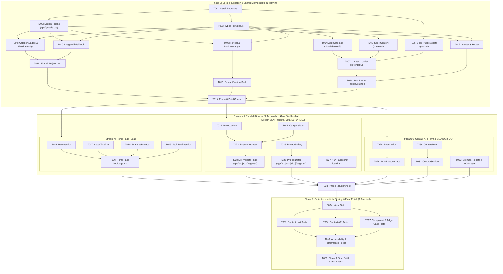

# Tasks: ICCañete Personal Portfolio Website

**Input**: Design documents from `/specs/001-portfolio-website/` (`spec.md`, `plan.md`, `research.md`, `data-model.md`, `contracts/`, `quickstart.md`) and `/specs/design/DESIGN.md`
**Execution Model**:
- **Phase 0 (Serial — 1 Terminal)**: Shared packages, design tokens/theme, content schemas + sample data, root layout, `Navbar`, `Footer`, and **all** shared components (`Reveal`, `SectionWrapper`, `CategoryBadge`, `TimelineBadge`, `ImageWithFallback`, `ProjectCard`, and `ContactSection` shell). Ends with a mandatory build check.
- **Phase 1 (Parallel — 3 Terminals: Stream A, Stream B, Stream C)**: Strictly disjoint file sets—**no two streams edit the same file**. Ends with a mandatory build check.
- **Phase 2 (Serial — 1 Terminal)**: Automated edge-case/accessibility tests, WCAG 2.1 AA & performance audit, and final build check.

---

## File Ownership Guardrail (Phase 1 Parallel Streams)

| Stream | User Story | Exclusive Files Created / Modified (Zero Overlap) |
| :--- | :--- | :--- |
| **Stream A** | `[US1]` Home Page Sections | `components/home/hero-section.tsx`, `components/home/about-timeline.tsx`, `components/home/featured-projects.tsx`, `components/home/tech-stack-section.tsx`, `app/page.tsx` |
| **Stream B** | `[US2]` All Projects, Project Detail, 404 | `components/projects/projects-hero.tsx`, `components/projects/category-tabs.tsx`, `components/projects/projects-browser.tsx`, `app/projects/page.tsx`, `components/projects/project-gallery.tsx`, `app/projects/[slug]/page.tsx`, `app/projects/[slug]/not-found.tsx`, `app/not-found.tsx` |
| **Stream C** | `[US3]` Contact Flow + `[US4]` SEO Metadata | `lib/rate-limit.ts`, `app/api/contact/route.ts`, `components/home/contact-form.tsx`, `components/home/contact-section.tsx`, `app/sitemap.ts`, `app/robots.ts`, `app/opengraph-image.tsx` |

---

## Phase 0: Serial Foundation & All Shared Components (Single Terminal)

**Purpose**: Install dependencies, configure design tokens and system theme in `app/globals.css`, implement content schemas and loaders, seed sample content/assets, and build the root layout, `Navbar`, `Footer`, and every shared component so Phase 1 streams can run in parallel without file conflicts.

**⚠️ CRITICAL**: Complete all Phase 0 tasks including `T015` (Phase 0 Build Check) before starting Phase 1.

- [x] T001 Install runtime (`resend`, `zod`, `gray-matter`, `next-mdx-remote`, `lucide-react`) and test (`vitest`, `@vitejs/plugin-react`, `jsdom`, `@testing-library/react`, `@testing-library/jest-dom`) packages and add `"test": "vitest run"` script in `package.json`
  - **DESIGN.md Reference**: Header & §1.3 (Icon & framework setup)
  - **Acceptance Criteria**:
    - `package.json` lists `resend`, `zod`, `gray-matter`, `next-mdx-remote`, and `lucide-react` in `dependencies` (`FR-022`, `FR-024`).
    - `package.json` lists `vitest`, `@vitejs/plugin-react`, `jsdom`, `@testing-library/react`, and `@testing-library/jest-dom` in `devDependencies` and defines `"test": "vitest run"` in `scripts` (`SC-003`).
    - `node_modules` installs cleanly with zero unresolved peer dependency errors.

- [x] T002 Configure three-layer CSS design tokens, Tailwind v4 `@theme inline` mappings, `@media (prefers-color-scheme: dark)` system theme overrides, and `@media (prefers-reduced-motion: reduce)` rules in `app/globals.css`
  - **DESIGN.md Reference**: §1.1 (Color Tokens), §1.4 (Spacing, Concentric Border Radii, and Elevation), §1.5 (Exact `app/globals.css` Token Implementation), §5.3 (Reduced Motion Override)
  - **Acceptance Criteria**:
    - `:root` defines all Light Mode semantic variables (`--bg-canvas: #F8FAFC`, `--bg-surface: #FFFFFF`, `--text-primary: #0F172A`, `--accent-primary: #2563EB`, etc.) as the default fallback when no system preference is reported (`FR-019`, `SC-004`).
    - `@media (prefers-color-scheme: dark)` overrides `:root` variables for Dark Mode (`--bg-canvas: #0B0F17`, `--bg-surface: #111827`, `--text-primary: #F8FAFC`, `--accent-primary: #60A5FA`, etc.) with no manual toggle (`FR-019`, `SC-004`).
    - `@theme inline` maps all semantic variables (`--color-canvas`, `--color-surface`, `--color-text-primary`, `--color-image-outline`, `--shadow-card`, `--shadow-card-hover`, `--font-sans`, `--font-mono`, etc.) (`FR-024`).
    - `@media (prefers-reduced-motion: reduce)` forces `animation-duration: 0.01ms !important`, `transition-duration: 0.01ms !important`, and `.reveal-hidden { opacity: 1 !important; transform: none !important; }` (`FR-020`, `SC-004`).

- [x] T003 Define TypeScript interfaces for `Profile`, `ProfileData`, `SocialLink`, `TimelineEntry`, `TechStackItem`, `ProjectsIntro`, `Project`, `ProjectImage`, `ProjectLink`, `ProjectDownload`, and `ContactSubmission` in `lib/types.ts`
  - **DESIGN.md Reference**: §1.2 (Semantic Category & Timeline Badge Tokens), §4.2–§4.11 (Component Props)
  - **Acceptance Criteria**:
    - Exports all entity interfaces matching `specs/001-portfolio-website/data-model.md` §2.1–§2.6 (`FR-001`–`FR-024`).
    - `TimelineEntry["type"]` is typed as the exact union `"work" | "school" | "career" | "certification" | "achievement"` (`FR-005`).
    - `TimelineEntry["endDate"]` is typed as `string | null | undefined` (`FR-006`).

- [x] T004 [P] Implement Zod validation schemas for content files (`profileSchema`, `timelineEntrySchema`, `techStackItemSchema`, `projectsIntroSchema`, `projectFrontmatterSchema`) in `lib/validations/content.ts` and contact payload (`contactSchema`) in `lib/validations/contact.ts`
  - **DESIGN.md Reference**: §4.2–§4.11 (Component States & Validation)
  - **Acceptance Criteria**:
    - `lib/validations/content.ts` validates `TimelineEntry.type` against `"work" | "school" | "career" | "certification" | "achievement"`, normalizes missing/empty `endDate` to `null` (`FR-006`), and provides safe defaults on `projectFrontmatterSchema` (`images: []`, `links: []`, `downloads: []`, `isFeatured: false`, `isBestInCategory: false`, `order: 999`) (`FR-008`, `FR-015`, `FR-024`).
    - `lib/validations/contact.ts` enforces exact constraints from `data-model.md` §2.6 and `contracts/contact-api.md` §1: `name` (`string().trim().min(1, "Name is required.").max(100, "Name must be 100 characters or fewer.")`), `email` (`string().trim().min(1, "Email is required.").email("Please enter a valid email address.").max(254)`), `message` (`string().trim().min(1, "Message is required.").max(2000, "Message exceeds the 2,000-character limit.")`), and optional honeypot `website` (`string().optional()`) (`FR-021`, `FR-022`).

- [x] T005 [P] Seed repository content files (`content/profile.json`, `content/timeline.json`, `content/tech-stack.json`, `content/projects-intro.json`) and 3 sample project MDX files across Software, Game Dev, and Hardware (`content/projects/sentinel-cloud-observability.mdx`, `content/projects/neon-drift-shader-engine.mdx`, `content/projects/autonomous-rover-telemetry.mdx`)
  - **DESIGN.md Reference**: §3.1–§3.3 (Page Wireframes & Content Structure)
  - **Acceptance Criteria**:
    - JSON files match the sample schemas in `specs/001-portfolio-website/data-model.md` §2.1–§2.4, including all 5 timeline entry types (`work`, `school`, `career`, `certification`, `achievement`) with at least one `endDate: null` ongoing entry (`FR-005`, `FR-006`, `FR-024`).
    - The 3 MDX files in `content/projects/` cover `"Software"`, `"Game Dev"`, and `"Hardware"`, each with valid YAML frontmatter (`title`, `shortDescription`, `category`, `isFeatured`, `isBestInCategory`, `order`, `images`, `links`, `downloads`) and multi-section Markdown body (`## Overview`, `## Technical Highlights`) (`FR-008`, `FR-010`, `FR-015`, `FR-024`).

- [x] T006 [P] Create static assets including sample resume PDF (`public/resume.pdf`), sample project download (`public/downloads/sentinel-architecture.pdf`), SVG tech stack icons (`public/icons/tech/*.svg`), and SVG project preview graphics (`public/images/projects/*.svg`)
  - **DESIGN.md Reference**: §4.2 (`HeroSection`), §4.6 (`TechStackSection`), §4.8 (`ProjectCard`)
  - **Acceptance Criteria**:
    - `public/resume.pdf` and `public/downloads/sentinel-architecture.pdf` exist as valid non-empty PDF files (`FR-004`, `FR-015`).
    - All icon paths referenced in `content/tech-stack.json` exist under `public/icons/tech/` (`FR-009`).
    - All image paths referenced in `content/projects/*.mdx` exist under `public/images/projects/` (`FR-008`, `FR-013`, `FR-015`).

- [x] T007 Implement server-side content loader functions (`getProfile`, `getTimeline`, `getTechStack`, `getProjectsIntro`, `getAllProjects`, `getFeaturedProjects`, `getCategoriesWithProjects`, `getProjectBySlug`) in `lib/content.ts`
  - **DESIGN.md Reference**: §4.2–§4.9, §4.11 (Data-driven Component States)
  - **Acceptance Criteria**:
    - Implements all function signatures and behavioral guarantees in `specs/001-portfolio-website/contracts/content-loader.md` §1–§2 (`FR-001`–`FR-017`, `FR-024`).
    - `getProfile()` filters out any social link with an empty `url` (`FR-003`) and sets `hasResumeFile` via `fs.existsSync` on `public/resume.pdf` (`FR-004`).
    - `getAllProjects()` and `getProjectBySlug()` filter out any `links` or `downloads` item with an empty `label` or `url`/`fileUrl` so malformed or broken entries never break project pages (`FR-008`, `FR-015`).
    - `getCategoriesWithProjects()` excludes categories with `0` projects (`FR-011`), orders categories by `projects-intro.json`'s `categoryOrder`, and selects `bestProject` as the first project with `isBestInCategory === true` or falls back to `projects[0]` (`FR-010`).

- [x] T008 [P] Implement non-blocking scroll-reveal wrapper (`components/ui/reveal.tsx`) and shared section layout container (`components/ui/section-wrapper.tsx`)
  - **DESIGN.md Reference**: §1.3 (Typography Scale), §1.4 (Spacing), §2.1–§2.2 (Responsive Breakpoints & `scroll-mt-20` Anchor Offset), §4.11 (`SectionWrapper` & `Reveal`), §5.1–§5.3 (Motion Specification)
  - **Acceptance Criteria**:
    - `components/ui/reveal.tsx` renders children immediately in SSR HTML (never hiding content if JS or `IntersectionObserver` is unavailable) and applies `260ms cubic-bezier(0.22, 1, 0.36, 1)` `opacity` + `translateY(8px -> 0)` transition with optional `delayMs` prop while respecting `prefers-reduced-motion: reduce` (`FR-020`, `SC-004`).
    - `components/ui/section-wrapper.tsx` renders `<section id={id} className="scroll-mt-20 py-14 md:py-20">` with centered container `mx-auto max-w-[1120px] px-4 sm:px-6 md:px-8` and optional monospace index eyebrow + `h2` heading (`FR-001`, `FR-018`).

- [x] T009 [P] Implement semantic `CategoryBadge` (`components/ui/category-badge.tsx`) and `TimelineBadge` (`components/ui/timeline-badge.tsx`) components
  - **DESIGN.md Reference**: §1.2 (Semantic Category & Timeline Badge Tokens), §4.4 (`TimelineBadge`), §4.11 (`CategoryBadge`)
  - **Acceptance Criteria**:
    - `CategoryBadge` maps `"Software"` to Blue (`info`), `"Game Dev"` to Violet (`creative`), `"Hardware"` to Amber (`hardware`), and any other category string to Neutral (`default`) with `rounded-full px-2.5 py-0.5 text-xs font-mono font-medium border` (`FR-008`, `FR-013`, `FR-015`).
    - `TimelineBadge` maps `"work"` (`Briefcase`, Blue), `"school"` (`GraduationCap`, Emerald), `"career"` (`Compass`, Violet), `"certification"` (`Award`, Cyan), and `"achievement"` (`Trophy`, Amber) with matching `14px` Lucide icon (`aria-hidden="true"`) and accessible text label (`FR-006`).

- [x] T010 [P] Implement client `ImageWithFallback` component in `components/ui/image-with-fallback.tsx`
  - **DESIGN.md Reference**: §1.1 (`--image-outline`), §4.8 (`ProjectCard` missing/broken image state), §4.9 (`ProjectGallery` failed image state), §4.11 (`ImageWithFallback`)
  - **Acceptance Criteria**:
    - Renders an image with `outline-1 -outline-offset-1 outline-image-outline` (`FR-024`).
    - When `src` is empty/undefined or `onError` fires, renders a clean geometric placeholder container (`bg-muted flex flex-col items-center justify-center gap-2 text-text-muted font-mono text-xs`) so missing or broken images never show a broken browser icon (`FR-008`, `FR-013`, `FR-015`, `SC-003`).

- [x] T011 Implement shared `ProjectCard` component in `components/projects/project-card.tsx`
  - **DESIGN.md Reference**: §1.4 (Concentric Radii & Elevation), §4.8 (`ProjectCard`), §5.2 (Project Card Hover Motion)
  - **Acceptance Criteria**:
    - Renders a full-card `<Link href={`/projects/${project.slug}${fromCategory ? `?from=${encodeURIComponent(fromCategory)}` : ""}`}>` with `rounded-2xl bg-surface border border-border-subtle shadow-card hover:border-border-strong hover:shadow-card-hover hover:-translate-y-0.5 transition-all duration-200` (`FR-014`, `FR-016`).
    - Displays top `16:9` `ImageWithFallback`, `CategoryBadge`, `h3` title, and `shortDescription` truncated with `line-clamp-3` so all cards maintain uniform height (`FR-008`, `FR-013`).
    - Handles incomplete optional project data gracefully without throwing (`FR-008`, `SC-003`).

- [x] T012 [P] Implement persistent responsive `Navbar` (`components/layout/navbar.tsx`) and site `Footer` (`components/layout/footer.tsx`)
  - **DESIGN.md Reference**: §2.2 (Sticky Navigation Bar), §3.1 (Desktop & Mobile Wireframes), §4.1 (`Navbar` States), §4.11 (`Footer`), §5.2 (Mobile Menu Motion)
  - **Acceptance Criteria**:
    - `Navbar` renders sticky header (`h-16 sticky top-0 z-40 bg-glass backdrop-blur-md border-b border-border-subtle`) with brand link (`/`) and links to `/#about`, `/#projects`, `/#tech-stack`, `/#contact`, plus `/projects` (`FR-018`).
    - On viewports `< 768px`, links collapse into a toggleable menu button (`min-h-11 min-w-11`, `aria-expanded`, `aria-controls`) that closes on link click or `Escape` key (`FR-018`, `SC-004`).
    - Cross-page section links use `/#section-id` so clicking them from `/projects` or `/projects/[slug]` navigates back to the Home page at that section (`FR-018`).

- [x] T013 [P] Create shared `ContactSection` mount shell in `components/home/contact-section.tsx`
  - **DESIGN.md Reference**: §3.1 (Home Wireframe `04 / CONTACT ME`), §4.10 (`ContactForm`), §4.11 (`ContactSection`)
  - **Acceptance Criteria**:
    - Exports `ContactSection` rendering `<SectionWrapper id="contact" index="04" title="Contact Me">` with a placeholder container so Stream A can import `ContactSection` in `app/page.tsx` during Phase 1 while Stream C replaces `components/home/contact-section.tsx` with the full `ContactForm` integration without any file conflict (`FR-001`, `FR-021`).

- [x] T014 Update root layout (`app/layout.tsx`) with `Geist` and `Geist Mono` fonts, site-wide metadata from `getProfile()`, `Navbar`, `<main>`, and `Footer`
  - **DESIGN.md Reference**: §1.3 (Typography Scale), §2.2 (Global Layout Rules), §3.1 (Wireframes), §4.11 (`Footer`)
  - **Acceptance Criteria**:
    - Configures `--font-geist-sans` and `--font-geist-mono` on `<html>`, applies `bg-canvas text-text-primary font-sans antialiased selection:bg-accent-primary selection:text-accent-on-primary`, and wraps `{children}` with `<Navbar />` and `<Footer />` (`FR-018`, `FR-019`).
    - Exports `metadata: Metadata` populated from `getProfile()` (`title.default`, `title.template: "%s | ICCañete"`, `description`, `openGraph`, `twitter`) (`FR-002`, `FR-024`).

- [x] T015 Execute **Phase 0 Build Check**: Run `npm run lint` and `npm run build` in repository root to verify all Phase 0 shared infrastructure and components compile with zero errors
  - **DESIGN.md Reference**: §1–§5 (Foundation Verification)
  - **Acceptance Criteria**:
    - `npm run lint` exits with code `0` (`SC-003`).
    - `npm run build` exits with code `0` and generates static/server bundles cleanly (`SC-003`).

**Checkpoint**: Phase 0 complete. Launch Stream A, Stream B, and Stream C in 3 parallel terminals.

---

## Phase 1 — Stream A: Home Page Sections (Priority: P1) 🎯 MVP

**Terminal Assignment**: Terminal 1 (`Stream A`)
**Exclusive Files**: `components/home/hero-section.tsx`, `components/home/about-timeline.tsx`, `components/home/featured-projects.tsx`, `components/home/tech-stack-section.tsx`, `app/page.tsx`
**Goal**: Deliver User Story 1 (`US1`)—visitors can scan identity, social links, resume download, About Me + unified timeline, Featured Projects, and Tech Stack on the Home page with all edge-case fallbacks.
**Independent Test**: Load `http://localhost:3000` and verify Hero actions (including missing-PDF fallback), About Me + Timeline combinations, Featured Projects cards, and Tech Stack icon error fallback.

- [x] T016 [P] [US1] Implement `HeroSection` component in `components/home/hero-section.tsx`
  - **DESIGN.md Reference**: §1.1 (Color Tokens), §1.3 (Display Hero Typography), §3.1 (Home Wireframe — Hero), §4.2 (`HeroSection` States), §5.2 (`scale(0.96)` Button Press)
  - **Acceptance Criteria**:
    - Renders `profile.handle` monospace pill, `profile.name` (`h1`), `profile.role`, and `profile.tagline` (`max-w-[62ch]`) inside initial-visible server HTML so slow connections never block text (`FR-002`, `FR-020`).
    - Renders social icon buttons (`min-h-11 min-w-11` / `44x44px`, `target="_blank" rel="noopener noreferrer"`) for all configured socials in `profile.socials` (`FR-003`).
    - Places `Download CV` button beside the social buttons: when `profile.hasResumeFile` is `true`, renders `<a href={profile.resumeUrl} download>`; when `false`, renders `<button type="button">` that toggles an inline message `"Resume not available right now."` (`role="status" aria-live="polite"`) without navigating to a broken link (`FR-004`).

- [x] T017 [P] [US1] Implement `AboutTimeline` component in `components/home/about-timeline.tsx`
  - **DESIGN.md Reference**: §1.2 (Timeline Badge Tokens), §1.3 (Typography Scale), §3.1 (Home Wireframe `01 / ABOUT ME & JOURNEY`), §4.3 (`AboutTimeline` States)
  - **Acceptance Criteria**:
    - Renders `About Me` narrative paragraphs (`max-w-[68ch]`) alongside the ordered unified timeline covering `"work" | "school" | "career" | "certification" | "achievement"` entries (`FR-005`).
    - Each timeline entry displays its `TimelineBadge`, `title`, `place`, date range in `font-mono tabular-nums` (rendering `"Ongoing"` when `endDate` is `null` or empty), and `description` (`FR-006`).
    - Enforces all 3 empty-state combinations (`FR-007`): if `aboutMe` is empty, renders only the timeline; if `timeline` is empty, renders only `aboutMe`; if both are empty, returns `null` so the entire section is hidden.
    - Uses single-column layout on small viewports (`< 1024px`) and wraps long text cleanly (`FR-007`).

- [x] T018 [P] [US1] Implement `FeaturedProjects` component in `components/home/featured-projects.tsx`
  - **DESIGN.md Reference**: §3.1 (Home Wireframe `02 / FEATURED PROJECTS`), §4.5 (`FeaturedProjects` States), §4.8 (`ProjectCard`)
  - **Acceptance Criteria**:
    - Renders a 3-column desktop (`grid-cols-1 md:grid-cols-2 lg:grid-cols-3 gap-6`) grid of `ProjectCard` items for all featured projects plus a `"See all projects"` button linking to `/projects` (`FR-008`).
    - Staggers card reveals by `80ms` (`max 240ms`) using `Reveal` (`DESIGN.md` §5.2).
    - If `projects.length === 0` (no project flagged as featured), renders only the `"See all projects"` button container (`FR-008`).

- [x] T019 [P] [US1] Implement `TechStackSection` component in `components/home/tech-stack-section.tsx`
  - **DESIGN.md Reference**: §3.1 (Home Wireframe `03 / TECH STACK`), §4.6 (`TechStackSection` States)
  - **Acceptance Criteria**:
    - Renders a responsive grid (`grid-cols-2 sm:grid-cols-3 md:grid-cols-4 gap-4`) showing each item's `24x24px` icon and `name` (`FR-009`).
    - If an item's `icon` path is empty or triggers `onError`, hides the broken image element and displays the item's `name` only (`FR-009`).
    - If `items.length === 0`, returns `null` so the entire section is hidden (`FR-009`).

- [x] T020 [US1] Assemble the complete Home page in `app/page.tsx`
  - **DESIGN.md Reference**: §2.1–§2.2 (Breakpoints & Anchor Offsets), §3.1 (Home Page Desktop & Mobile Wireframes)
  - **Acceptance Criteria**:
    - Loads `getProfile()`, `getTimeline()`, `getFeaturedProjects()`, and `getTechStack()` from `lib/content.ts`.
    - Renders `HeroSection`, `AboutTimeline`, `FeaturedProjects`, `TechStackSection`, and `ContactSection` in vertical order with matching section anchor IDs (`#about`, `#projects`, `#tech-stack`, `#contact`) (`FR-001`, `FR-018`).

---

## Phase 1 — Stream B: All Projects Page, Project Detail Page & 404 (Priority: P2)

**Terminal Assignment**: Terminal 2 (`Stream B`)
**Exclusive Files**: `components/projects/projects-hero.tsx`, `components/projects/category-tabs.tsx`, `components/projects/projects-browser.tsx`, `app/projects/page.tsx`, `components/projects/project-gallery.tsx`, `app/projects/[slug]/page.tsx`, `app/projects/[slug]/not-found.tsx`, `app/not-found.tsx`
**Goal**: Deliver User Story 2 (`US2`)—visitors can browse all projects by category, see each category's best project in the Projects Hero, open full Project Detail pages with galleries/links/downloads, return to the originating category tab, and hit a helpful 404 page on invalid project slugs.
**Independent Test**: Open `http://localhost:3000/projects`, switch category tabs, open a project detail page, verify back-to-category navigation, and test `/projects/non-existent`.

- [x] T021 [P] [US2] Implement `ProjectsHero` spotlight component in `components/projects/projects-hero.tsx`
  - **DESIGN.md Reference**: §1.4 (Concentric Border Radius System `rounded-[20px]` outer / `rounded-lg` inner), §3.2 (All Projects Wireframe — Projects Hero), §4.7 (`ProjectsHero` States)
  - **Acceptance Criteria**:
    - Displays the page `headline` (`h1`) and `explanation` paragraph from `ProjectsIntro`; if `explanation` is empty (`""`), omits the explanation paragraph and shows only the `bestProject` spotlight card (`FR-010`).
    - Renders a clickable spotlight card linking to `/projects/${bestProject.slug}?from=${encodeURIComponent(activeCategory)}` showing the selected category's `bestProject` (`title`, `shortDescription`, `CategoryBadge`, `"Featured in Category"` badge, and `16:9` `ImageWithFallback` main image) (`FR-010`, `FR-014`).

- [x] T022 [P] [US2] Implement accessible `CategoryTabs` component in `components/projects/category-tabs.tsx`
  - **DESIGN.md Reference**: §3.2 (All Projects Wireframe — Category Tabs), §4.7 (`CategoryTabs` States), §5.2 (`scale(0.96)` Tab Press)
  - **Acceptance Criteria**:
    - Renders `role="tablist"` with buttons (`role="tab"`, `aria-selected`, `min-h-11 px-4 rounded-[10px] font-mono text-sm`) for each populated category and its project count (`FR-011`, `FR-012`).
    - If `categories.length <= 1`, returns `null` so no extra tabs are rendered when only one category exists (`FR-011`).

- [x] T023 [US2] Implement client `ProjectsBrowser` state & URL sync component in `components/projects/projects-browser.tsx`
  - **DESIGN.md Reference**: §3.2 (All Projects Wireframe), §4.7 (`ProjectsBrowser` States), §5.2 (Category Tab Content Switch `150ms`)
  - **Acceptance Criteria**:
    - Reads initial `?category=` search param (falling back to `categories[0].category` if absent or invalid) and updates the URL query parameter via `window.history.replaceState` when a tab is clicked without causing a full page reload (`FR-012`, `FR-016`).
    - Switching a tab updates both `ProjectsHero` (`bestProject` for that category) and the 3-column `ProjectCard` grid while keeping the `intro.explanation` text unchanged (`FR-010`, `FR-012`).
    - If `categories.length === 0`, renders the `"Projects coming soon"` empty state card (`FR-011`).

- [x] T024 [US2] Implement the All Projects page route in `app/projects/page.tsx`
  - **DESIGN.md Reference**: §3.2 (Page 2: All Projects Wireframes)
  - **Acceptance Criteria**:
    - Exports static `metadata: Metadata` (`title: "All Projects"`, `description` from `getProjectsIntro().explanation`) (`FR-010`).
    - Loads `getProjectsIntro()` and `getCategoriesWithProjects()` on the server and renders `ProjectsBrowser` wrapped in `<Suspense>` for client search-param reading (`FR-010`, `FR-011`, `FR-012`, `SC-002`).

- [x] T025 [P] [US2] Implement multi-picture `ProjectGallery` component in `components/projects/project-gallery.tsx`
  - **DESIGN.md Reference**: §3.3 (Page 3 Wireframe — Project Gallery), §4.9 (`ProjectGallery` States)
  - **Acceptance Criteria**:
    - Renders all images in `project.images` inside a readable responsive grid (`grid-cols-1 md:grid-cols-2 gap-6`) with `ImageWithFallback` (`16:9` frame, `rounded-xl`, `outline-image-outline`) and optional `<figcaption>` (`FR-015`).
    - If an individual picture fails to load, `ImageWithFallback` keeps the rest of the gallery and page content intact (`FR-015`, `SC-003`).
    - Returns `null` when `images.length === 0` (`FR-015`).

- [x] T026 [US2] Implement the Project Detail page route in `app/projects/[slug]/page.tsx`
  - **DESIGN.md Reference**: §2.2 (Readable Text Measure `max-w-[68ch]`), §3.3 (Page 3: Project Detail Wireframe), §4.11 (Project Detail Links & Downloads Bar)
  - **Acceptance Criteria**:
    - Exports `generateStaticParams()` from `getAllProjects()` and `generateMetadata({ params })` (awaiting `params: Promise<{ slug: string }>`) (`FR-015`).
    - Calls `notFound()` when `getProjectBySlug(slug)` returns `null` (`FR-017`, `SC-003`).
    - Renders a `"Back to Projects"` link at the top that reads `?from=` from `searchParams` and links to `/projects?category=${encodeURIComponent(from)}` (or `/projects` when absent) (`FR-016`).
    - Renders `CategoryBadge`, `project.title` (`h1`), `project.shortDescription`, external `project.links` (`target="_blank" rel="noopener noreferrer"`, hidden if `links.length === 0`), downloadable `project.downloads` (`download` attribute with `fileSize` badge, hidden if `downloads.length === 0`), main hero image, MDX `fullDetails` compiled via `next-mdx-remote/rsc` in a `max-w-[68ch]` prose container, and `ProjectGallery`—isolating external links and downloads as standalone anchor elements so an unreachable link or download never breaks the page (`FR-015`, `SC-003`).

- [x] T027 [P] [US2] Implement Project 404 page (`app/projects/[slug]/not-found.tsx`) and global 404 page (`app/not-found.tsx`)
  - **DESIGN.md Reference**: §3.3 (Project Not Found `404` Wireframe)
  - **Acceptance Criteria**:
    - Both `app/projects/[slug]/not-found.tsx` and `app/not-found.tsx` render a centered card (`max-w-lg mx-auto my-20 p-8 rounded-2xl bg-surface border border-border-subtle text-center`) with a `404 NOT FOUND` monospace badge, heading, explanation message, and a primary CTA button linking back to `/projects` (`FR-017`, `SC-003`).

---

## Phase 1 — Stream C: Contact Form + Resend API Route & SEO Metadata (Priority: P3 & P4)

**Terminal Assignment**: Terminal 3 (`Stream C`)
**Exclusive Files**: `lib/rate-limit.ts`, `app/api/contact/route.ts`, `components/home/contact-form.tsx`, `components/home/contact-section.tsx`, `app/sitemap.ts`, `app/robots.ts`, `app/opengraph-image.tsx`
**Goal**: Deliver User Story 3 (`US3`)—validated Contact Me form and `POST /api/contact` Resend route handler with duplicate-submit and spam protection—and User Story 4 (`US4`) SEO/crawler discovery routes.
**Independent Test**: Submit invalid/valid payloads to `#contact` and `POST /api/contact`, verify validation errors, loading lock, Resend email payload, and error state input preservation, and inspect `/sitemap.xml`, `/robots.txt`, and `/opengraph-image`.

- [x] T028 [P] [US3] Implement in-memory per-IP sliding-window rate limiter (`max 3 requests per 10 minutes`) in `lib/rate-limit.ts`
  - **DESIGN.md Reference**: §4.10 (`ContactForm` Error / Rate-Limit States)
  - **Acceptance Criteria**:
    - Exports `checkRateLimit(ip: string): { allowed: boolean; retryAfterSeconds: number }` enforcing a limit of 3 requests per `600_000ms` window per IP (`FR-022`, `contracts/contact-api.md` §2.3) and a helper `resetRateLimits()` for testing.

- [x] T029 [US3] Implement `POST /api/contact` Route Handler with Zod validation, honeypot spam check, rate limiting, and Resend email delivery in `app/api/contact/route.ts`
  - **DESIGN.md Reference**: §4.10 (`ContactForm` API Integration)
  - **Acceptance Criteria**:
    - Validates request JSON with `contactSchema` (`name` 1..100 chars, `email` valid email max 254 chars, `message` 1..2000 chars); returns `400` with `{ ok: false, message, fieldErrors }` on invalid fields (`FR-021`, `contracts/contact-api.md` §2.2).
    - Rejects requests where honeypot field `website` is non-empty with `400` (`FR-022`).
    - Returns `429` when `checkRateLimit` returns `allowed: false` (`FR-022`, `contracts/contact-api.md` §2.3).
    - Checks `process.env.RESEND_API_KEY` and `process.env.CONTACT_RECIPIENT_EMAIL`; if missing or if `resend.emails.send` fails/throws, logs diagnostic details via `console.error` and returns `500` with the safe message `"We couldn't send your message right now. Your text has been kept—please try again in a moment."` (`FR-023`, `SC-003`, `contracts/contact-api.md` §2.4).
    - Sends email via `Resend` with `replyTo: validatedData.email` and returns `200` `{ ok: true, message: "Message sent! Thank you for reaching out—I'll get back to you soon." }` (`FR-022`, `FR-023`, `SC-005`).

- [x] T030 [P] [US3] Implement client `ContactForm` component in `components/home/contact-form.tsx`
  - **DESIGN.md Reference**: §1.1 (Status Tokens), §3.1 (Home Wireframe `04 / CONTACT ME`), §4.10 (`ContactForm` States), §5.2 (`scale(0.96)` Button Press)
  - **Acceptance Criteria**:
    - Renders controlled inputs for `name` (required, max 100 chars), `email` (required, valid email), `message` (required, max 2,000 chars with live `tabular-nums` `${message.length} / 2000` counter that turns `text-status-error-text` if `> 2000`), and hidden honeypot `website` (`className="sr-only" tabIndex={-1} autoComplete="off" aria-hidden="true"`) (`FR-021`, `FR-022`).
    - Validates client-side with `contactSchema` before sending; marks invalid fields with `aria-invalid="true"` and renders field-specific `
` error messages (`FR-021`, `SC-005`).
    - Ignores duplicate clicks while `isSubmitting === true` (`disabled={isSubmitting}`, `aria-busy={isSubmitting}`) (`FR-022`).
    - On `200 OK`, shows the green confirmation banner (`role="status"`) displaying `"Message sent! Thank you for reaching out—I'll get back to you soon."` and clears `name`, `email`, and `message` to `""` (`FR-023`, `SC-005`).
    - On `400`/`429`/`500` or network failure, shows the red error banner (`role="alert"`) suggesting the visitor try again while **keeping** their typed `name`, `email`, and `message` intact (`FR-023`, `SC-003`, `SC-005`).

- [x] T031 [US3] Replace the Phase 0 stub in `components/home/contact-section.tsx` with the complete Contact Me section rendering `ContactForm`
  - **DESIGN.md Reference**: §3.1 (Home Wireframe `04 / CONTACT ME`), §4.10 (`ContactForm`), §4.11 (`ContactSection`)
  - **Acceptance Criteria**:
    - Wraps `ContactForm` inside `<SectionWrapper id="contact" index="04" title="Contact Me">` with introductory prompt copy and a `rounded-2xl bg-surface border border-border-subtle p-6 md:p-8 shadow-card` container (`FR-001`, `FR-021`).

- [x] T032 [P] [US4] Implement dynamic `sitemap.ts` (`app/sitemap.ts`), `robots.ts` (`app/robots.ts`), and OpenGraph preview image (`app/opengraph-image.tsx`)
  - **DESIGN.md Reference**: §1.1 (Color Tokens), §1.3 (Typography)
  - **Acceptance Criteria**:
    - `app/sitemap.ts` generates sitemap entries for `/`, `/projects`, and every `/projects/[slug]` returned by `getAllProjects()` (`FR-014`, `FR-024`).
    - `app/robots.ts` allows all user agents on `/` and references `/sitemap.xml` (`FR-024`).
    - `app/opengraph-image.tsx` renders a `1200x630` `ImageResponse` card displaying the portfolio owner's name, role, and tagline using the Direction 1 Deep Obsidian Slate palette (`#0B0F17` canvas, `#F8FAFC` title, `#60A5FA` accent) (`FR-002`, `FR-024`).

---

## Phase 1 Build Check (After Streams A, B, and C Complete)

- [x] T033 Execute **Phase 1 Build Check**: Run `npm run lint` and `npm run build` in repository root after merging/completing Streams A, B, and C
  - **DESIGN.md Reference**: All Sections (§1–§5)
  - **Acceptance Criteria**:
    - `npm run lint` passes with zero warnings or errors (`SC-003`).
    - `npm run build` succeeds and prerenders `/`, `/projects`, `/projects/sentinel-cloud-observability`, `/projects/neon-drift-shader-engine`, `/projects/autonomous-rover-telemetry`, `/sitemap.xml`, `/robots.txt`, and `/opengraph-image` alongside dynamic `/api/contact` (`FR-001`–`FR-024`, `SC-003`).

---

## Phase 2: Serial Accessibility, Performance, Testing & Final Polish (Single Terminal)

**Purpose**: Verify all 31 edge cases, WCAG 2.1 AA accessibility criteria, system theme rules, and `prefers-reduced-motion` behavior with automated tests and final polish.

- [ ] T034 Configure Vitest test runner (`vitest.config.ts`) and Testing Library setup (`tests/setup.ts`)
  - **DESIGN.md Reference**: Verification & Quality Gates
  - **Acceptance Criteria**:
    - `vitest.config.ts` resolves the `@/*` path alias to `./*` and uses the `jsdom` environment (`SC-003`).
    - `tests/setup.ts` imports `@testing-library/jest-dom/vitest` and provides a clean `IntersectionObserver` mock for component tests (`FR-020`, `SC-003`).

- [ ] T035 [P] Write unit tests for content loaders and all missing/empty data edge cases in `tests/content.test.ts`
  - **DESIGN.md Reference**: §4.2–§4.9, §4.11 (Data Edge Cases)
  - **Acceptance Criteria**:
    - Tests `getProfile()` (filters empty social URLs, sets `hasResumeFile` for `FR-003`, `FR-004`), `getTimeline()` (normalizes missing `endDate` to `null` for `"Ongoing"` in `FR-006`), `getAllProjects()` (filters empty project links/downloads in `FR-015`), `getCategoriesWithProjects()` (excludes empty categories and falls back to first project when no project has `isBestInCategory: true` in `FR-010`, `FR-011`), and `getProjectBySlug()` (returns `null` on unknown slug in `FR-017`, `SC-003`).

- [ ] T036 [P] Write unit and integration tests for `POST /api/contact` in `tests/contact-api.test.ts`
  - **DESIGN.md Reference**: §4.10 (`ContactForm` & API Error States)
  - **Acceptance Criteria**:
    - Verifies `400` on empty required fields, invalid email, message `> 2000` characters, and non-empty `website` honeypot (`FR-021`, `FR-022`, `SC-005`).
    - Verifies `429` when more than 3 submissions arrive from the same IP within 10 minutes (`FR-022`).
    - Verifies `200` on valid submission with `replyTo` set to the visitor's email, and `500` with safe user-facing error message when `RESEND_API_KEY` is missing or Resend fails (`FR-023`, `SC-003`, `SC-005`).

- [ ] T037 [P] Write component tests for Hero CV fallback, About/Timeline empty states, Category Tabs switching, and ContactForm input preservation in `tests/components.test.tsx`
  - **DESIGN.md Reference**: §4.2, §4.3, §4.7, §4.10
  - **Acceptance Criteria**:
    - Verifies clicking `Download CV` when `hasResumeFile === false` shows `"Resume not available right now."` without broken navigation (`FR-004`, `SC-003`).
    - Verifies `AboutTimeline` hides when both `aboutMe` and `timeline` are empty, and renders `"Ongoing"` for entries without `endDate` (`FR-006`, `FR-007`, `SC-003`).
    - Verifies `ProjectsBrowser` switches category tabs and hides `CategoryTabs` when only 1 category is provided (`FR-011`, `FR-012`, `SC-002`).
    - Verifies `ContactForm` clears inputs on `200 OK` and preserves typed inputs on `500` error (`FR-023`, `SC-003`, `SC-005`).

- [ ] T038 Audit and polish WCAG 2.1 AA accessibility (`aria-label`, `focus-visible` rings, semantic landmarks, `scroll-mt-20` offsets, `>= 44x44px` hit areas) and reduced-motion behavior across `app/` and `components/`
  - **DESIGN.md Reference**: §1.1 (Contrast Ratios), §2.2 (`scroll-mt-20`), §4.1–§4.11 (Focus & ARIA States), §5.3 (`prefers-reduced-motion`)
  - **Acceptance Criteria**:
    - Every icon-only button (`Navbar` mobile toggle, `HeroSection` social links) has an explicit `aria-label` and `min-h-11 min-w-11` (`44x44px`) hit target (`FR-002`, `FR-018`, `SC-004`).
    - Decorative icons beside text carry `aria-hidden="true"` (`SC-004`).
    - All interactive controls include `focus-visible:outline-2 focus-visible:outline-offset-2 focus-visible:outline-focus-ring` (`SC-004`).

- [ ] T039 Execute **Phase 2 Final Build & Verification Check**: Run `npm run lint`, `npm run test`, and `npm run build` in repository root
  - **DESIGN.md Reference**: All Sections (§1–§5)
  - **Acceptance Criteria**:
    - `npm run lint` exits with code `0` (`SC-003`).
    - `npm run test` passes 100% of unit, API, and component test suites (`SC-001`–`SC-005`).
    - `npm run build` exits with code `0` with all static and dynamic routes verified (`FR-001`–`FR-024`, `SC-003`).

---

## Dependencies & Execution Order

---

## Parallel Execution Commands (Phase 1)

Once **Phase 0 (`T001`–`T015`)** passes `npm run build`, run the three Phase 1 streams simultaneously in three separate terminals:

- **Terminal 1 (Stream A — Home Page `[US1]`)**: Execute `T016`, `T017`, `T018`, `T019` → `T020`.
- **Terminal 2 (Stream B — All Projects, Detail & 404 `[US2]`)**: Execute `T021`, `T022` → `T023` → `T024`, and `T025` → `T026`, `T027`.
- **Terminal 3 (Stream C — Contact Flow & SEO `[US3]`, `[US4]`)**: Execute `T028` → `T029`, `T030` → `T031`, and `T032`.

After all three terminals finish, run **`T033` (`npm run lint && npm run build`)** in a single terminal before proceeding to **Phase 2 (`T034`–`T039`)**.
